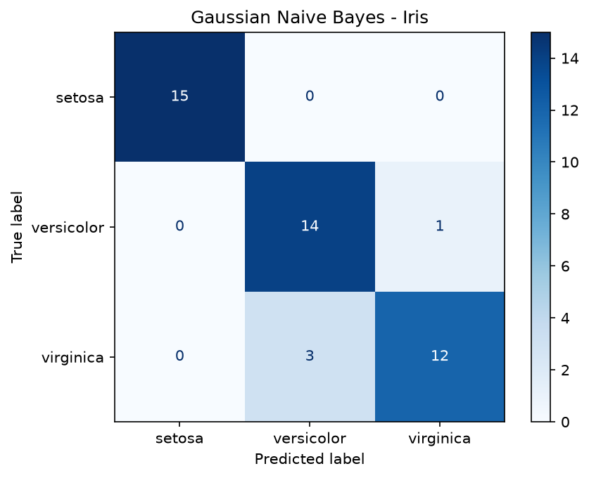

# Naive Bayes Classifier

**Author:** Bakhtawar Ali

## Objective
To apply the Naive Bayes algorithm for classification on two datasets and
evaluate its performance.

## Algorithm in Simple Words
Naive Bayes uses Bayes' theorem to calculate the probability of each class
given the input features, then picks the most probable class.

P(Class | Features) = P(Features | Class) x P(Class) / P(Features)

It is called "naive" because it assumes all features are independent of
each other, which is rarely fully true but works surprisingly well.

## Datasets
1. **Iris** (built into scikit-learn): 150 flowers, 4 numeric features,
   3 classes (setosa, versicolor, virginica).
2. **Play Tennis**: 14 rows, 4 categorical features (Outlook, Temp, Humidity,
   Wind), target Decision (Yes/No).

## Methods
| Dataset | Model | Why |
|---|---|---|
| Iris | GaussianNB | Features are continuous numbers |
| Play Tennis | CategoricalNB (alpha = 1) | Features are categories |

Iris was split 70% training (105 rows) and 30% testing (45 rows),
with random_state = 42.

## Tools Used
Python 3.11, pandas, scikit-learn, matplotlib.

## How to Run (Mac)
```bash
git clone https://github.com/Bakhtawar560/naive-bayes-classifier.git
cd naive-bayes-classifier
python3 -m venv venv
source venv/bin/activate
pip install -r requirements.txt
python3 src/naive_bayes.py
```

## Results
| Dataset | Accuracy | Note |
|---|---|---|
| Iris | 91.11% | Tested on unseen data (45 rows) |
| Play Tennis | 92.86% | Tested on its own 14 training rows |

Play Tennis prediction for (Sunny, Cool, Normal, Weak): **Yes**
(Yes = 79.87%, No = 20.13%).

Iris per-class results: setosa was classified perfectly (F1 = 1.00);
versicolor and virginica were sometimes confused (F1 = 0.88 and 0.86).

Iris confusion matrix:



## Conclusion
FILL IN: write 3 to 4 sentences in your own words.